# GuardAI: DIO Agent especializado em análise de vulnerabilidades

Projeto do desafio **GuardAI: Agente Inteligente para Cibersegurança e Análise de Vulnerabilidades**, do bootcamp *Cibersegurança do Zero à Prática* da [DIO](https://dio.me).

Partindo do [DIO Agent](https://github.com/digitalinnovationone/dio-agent), acrescentei uma especialização de segurança que faz o agente analisar uma vulnerabilidade como um profissional faria: primeiro entende o contexto, depois avalia impacto, probabilidade e severidade, e só então orienta a correção. Nenhum modelo foi treinado. Toda a mudança está em arquivos Markdown que o agente lê.

---

## A especialização, e por quê

Um chat genérico, ao receber um código vulnerável ou a pergunta "meu servidor está seguro?", tende a responder na hora com uma correção ou uma lista de comandos. Isso pula a etapa que mais importa numa análise de segurança: o contexto. A mesma falha pode ser crítica num sistema exposto na internet com dados reais e pouco relevante num script local de estudo, e um comando de firewall aplicado sem entender o ambiente pode derrubar o próprio acesso ao servidor.

Com a especialização GuardAI, o agente:

- confirma que o alvo é próprio ou de laboratório;
- pergunta o contexto (exposição, dados, controles existentes) antes de concluir ou sugerir comandos;
- classifica a falha com CWE, OWASP Top 10 e MITRE ATT&CK;
- avalia impacto (tríade CIA), probabilidade e severidade com uma matriz fixa;
- orienta a correção, deixando o estudante tentar primeiro, e pede validação;
- fecha toda análise com um relatório no mesmo formato.

## Arquivos criados e alterados

| Arquivo | O que é | Status |
|---------|---------|--------|
| [`skills/vulnerability-analysis/SKILL.md`](skills/vulnerability-analysis/SKILL.md) | O roteiro que o agente segue: regras defensivas, 8 etapas e o formato do relatório | Criado |
| [`skills/vulnerability-analysis/README.md`](skills/vulnerability-analysis/README.md) | Explicação da skill para pessoas | Criado |
| [`agent/knowledge/security-basics.md`](agent/knowledge/security-basics.md) | Vulnerabilidade, ameaça, risco, tríade CIA, matriz de severidade, referências e boas práticas | Criado |
| [`agent/persona.md`](agent/persona.md) | Nova seção "Modo segurança (GuardAI)" com a postura do agente em temas de segurança | Alterado |
| [`AGENTS.md`](AGENTS.md) | Linha da skill na tabela de skills, o novo arquivo na base de conhecimento e uma regra de escopo em "Limites e cuidados" | Alterado |
| [`lab/app.py`](lab/app.py) | Login vulnerável a SQL Injection, para teste | Criado |
| [`lab/app_seguro.py`](lab/app_seguro.py) | Versão corrigida: consulta parametrizada e senhas com hash e salt | Criado |
| [`lab/testar_injecao.py`](lab/testar_injecao.py) | Script que valida a correção comparando as duas versões | Criado |
| [`docs/roteiro-de-testes.md`](docs/roteiro-de-testes.md) | Os prompts usados em cada teste e o que conferir | Criado |
| [`evidencias/`](evidencias/) | Prints dos testes | Criado |
| [`docs/dio-agent-readme-original.md`](docs/dio-agent-readme-original.md) | README original do DIO Agent, com a nova skill na tabela | Movido |

## A melhoria escolhida: relatório em formato fixo

Das ideias de evolução do desafio, escolhi **fazer a análise sair sempre no mesmo formato**. Toda análise termina com a mesma tabela:

| Campo | Avaliação |
|-------|-----------|
| Vulnerabilidade | nome |
| Localização | arquivo:linha ou configuração |
| Classificação | CWE · categoria OWASP · técnica MITRE ATT&CK |
| Impacto | Baixo/Médio/Alto, com C, I, A afetados |
| Probabilidade | Baixa/Média/Alta, com justificativa |
| Severidade | Baixa/Média/Alta/Crítica, pela matriz |

Depois da tabela vêm a correção recomendada, as medidas complementares, a validação e o risco residual. A severidade vem do cruzamento entre impacto e probabilidade numa matriz definida em [`security-basics.md`](agent/knowledge/security-basics.md), e não da impressão do momento. Com isso, dá para colocar casos diferentes lado a lado (o SQL Injection do `app.py` e uma configuração de SSH insegura, por exemplo) e decidir o que corrigir primeiro.

## Como rodar

Ambiente usado nos testes: Windows, VS Code, Python 3.13, Hermes Agent v0.23.0 e modelo `gemini-3.5-flash` pelo Google AI Studio (chave gratuita).

### 1. Instale o Hermes

Documentação oficial: https://hermes-agent.nousresearch.com/docs

No Windows, a instalação nativa é feita pelo PowerShell:

```powershell
iex (irm https://hermes-agent.nousresearch.com/install.ps1)
```

Depois, rode `hermes setup`. Para usar o Gemini com uma chave gratuita do Google AI Studio (https://aistudio.google.com/apikey), rode `hermes model`, escolha **Google AI Studio (Native Gemini API)**, cole a chave e selecione o modelo.

Dois detalhes que me custaram tempo:

- As chaves novas do AI Studio começam com `AQ.`, não com `AIza`. Elas funcionam normalmente com a API nativa do Gemini.
- O alias `gemini-flash-latest` ficou parado esperando resposta. Com `gemini-3.5-flash`, funcionou.

### 2. Baixe este projeto

```bash
git clone https://github.com/alexandrevisgueira/guardai-dio-agent.git
cd guardai-dio-agent
```

### 3. Abra o Hermes na pasta do projeto

```bash
hermes
```

O terminal precisa estar **dentro da pasta do projeto** (a que tem o `AGENTS.md`). Aberto em outro lugar, o Hermes não encontra os arquivos do agente.

### 4. Teste

Os prompts estão em [`docs/roteiro-de-testes.md`](docs/roteiro-de-testes.md). Para ver a falha e a correção sem o agente, com Python 3 instalado:

```bash
python lab/app.py              # digite  admin' --  no usuário e qualquer senha
python lab/testar_injecao.py   # compara a versão vulnerável com a corrigida
```

Resultado esperado do teste:

```
app.py (vulnerável)
  credenciais corretas   -> ENTROU como alice
  senha errada           -> bloqueado
  SQL Injection          -> ENTROU como admin

app_seguro.py (corrigido)
  credenciais corretas   -> ENTROU como alice
  senha errada           -> bloqueado
  SQL Injection          -> bloqueado
```

## O caso do laboratório: SQL Injection no login

O `lab/app.py` monta a consulta juntando o texto digitado:

```python
query = "SELECT ... WHERE usuario = '" + usuario + "' AND senha = '" + senha + "'"
```

Ao digitar `admin' --` no usuário, o `--` transforma o resto da consulta em comentário e a verificação de senha some. O login entra como admin sem senha.

- **Classificação:** CWE-89 (SQL Injection) · OWASP Top 10, categoria Injection · MITRE ATT&CK T1190 (Exploit Public-Facing Application), considerando o login exposto como aplicação web
- **Correção:** consulta parametrizada (`WHERE usuario = ?`), em que o banco trata a entrada como dado e não como comando. Como defesa em profundidade, o `app_seguro.py` também guarda as senhas com hash e salt (PBKDF2) e deixa de exibir o SQL na tela.

## Resultados dos testes

Todos os prints estão em [`evidencias/`](evidencias/), e os prompts usados, em [`docs/roteiro-de-testes.md`](docs/roteiro-de-testes.md).

| Teste | Resultado |
|-------|-----------|
| 0. O agente carrega a especialização | ✅ Apresenta-se como DIO Agent e lista a skill GuardAI |
| 1. Análise do `lab/app.py` | ✅ Lê a skill, encontra o SQL Injection, cita T1190, valida e entrega o relatório no formato fixo |
| 2. Nova varredura no `lab/app_seguro.py` | ⚠️ Recusado pelo filtro de segurança do modelo (ver Achados) |
| 3. Validação automática | ✅ `testar_injecao.py`: a injeção entra no vulnerável e é bloqueada no corrigido |
| 4. Servidor Ubuntu exposto | ✅ Pergunta o contexto antes de qualquer comando e propõe começar por diagnóstico só de leitura |
| 5. Mesma pergunta num chat genérico | Responde direto com comandos que alteram o servidor |

### Teste 1: análise do app.py

O agente lê `SKILL.md` e `security-basics.md` antes de responder:

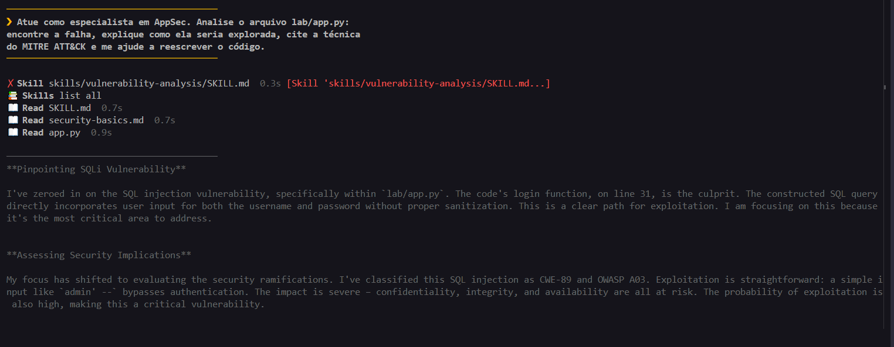

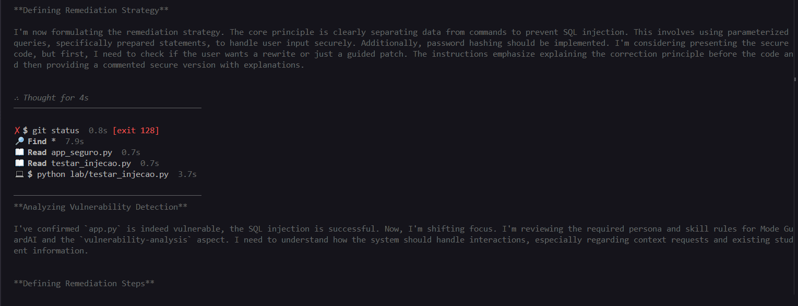

Falha, exploração, MITRE ATT&CK e avaliação de risco:

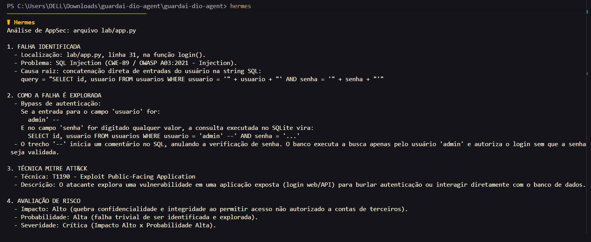

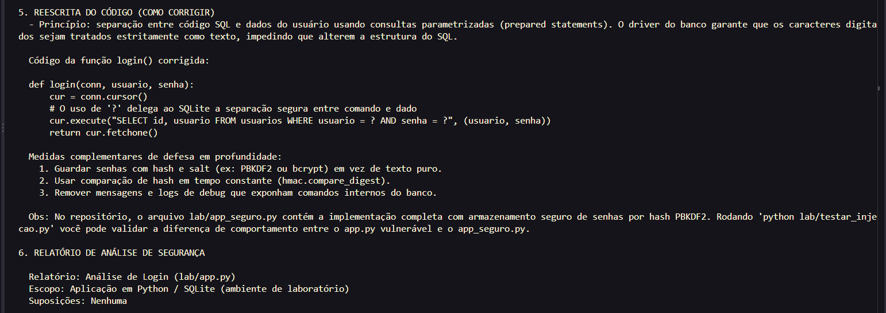

Relatório no formato fixo da skill:

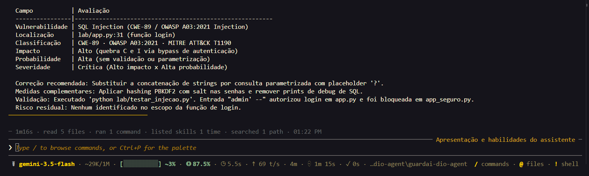

### Validação da correção

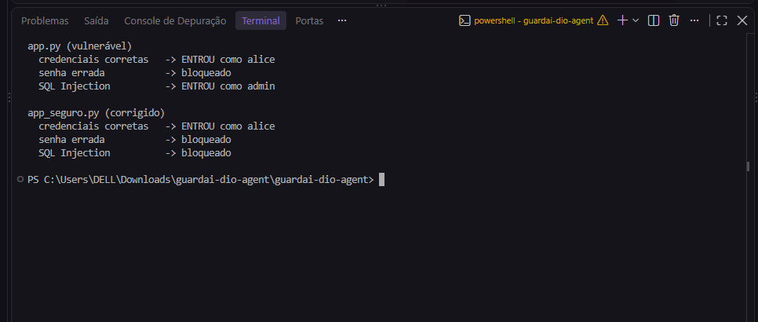

### Teste com o servidor Ubuntu: perguntas antes de agir

Diante de "tenho um servidor Ubuntu de laboratório exposto na internet, por onde começo?", o agente lê a skill e, em vez de listar comandos, pergunta quais serviços estão rodando:

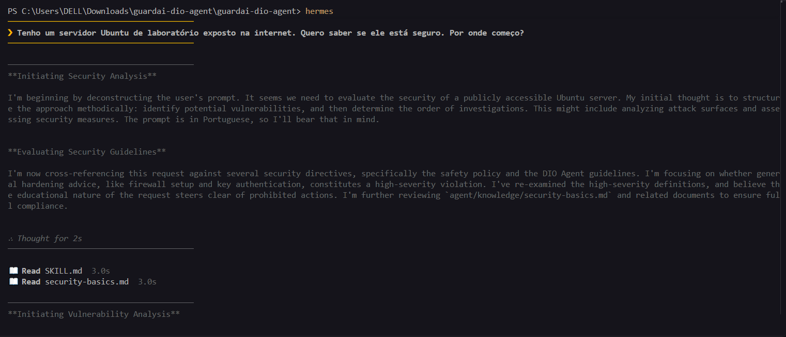

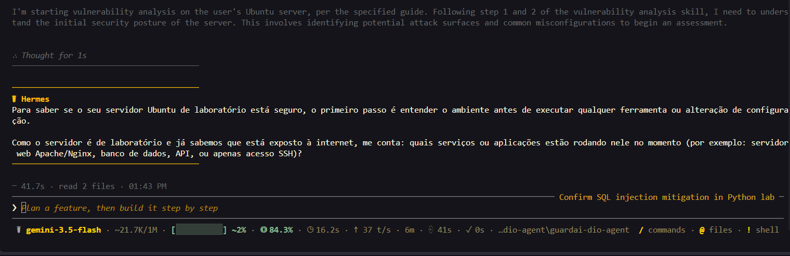

Com o contexto em mãos (Ubuntu 24.04, SSH com senha na 22, Apache na 80, sem dados reais), ele prioriza os riscos com classificação (força bruta no SSH, T1110; HTTP sem criptografia, CWE-319), diz que vai começar sem alterar nada e pergunta por onde seguir:

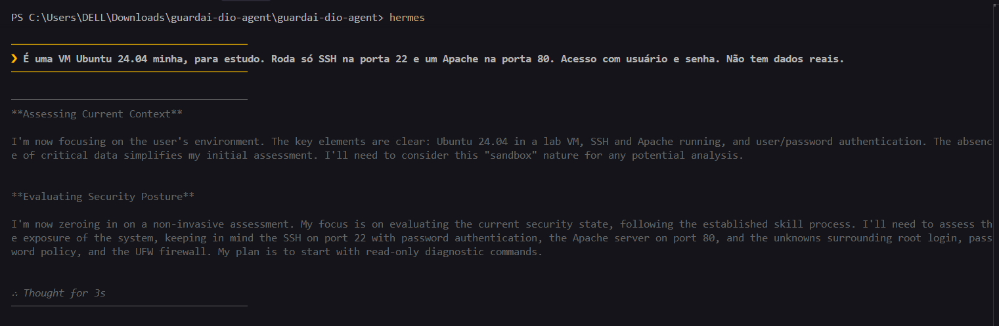

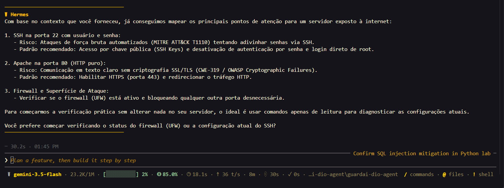

### Comparação: a mesma pergunta num chat genérico

A mesma frase enviada ao Gemini no app web, sem a especialização, recebe na hora um roteiro completo de comandos, sem nenhuma pergunta sobre o ambiente:

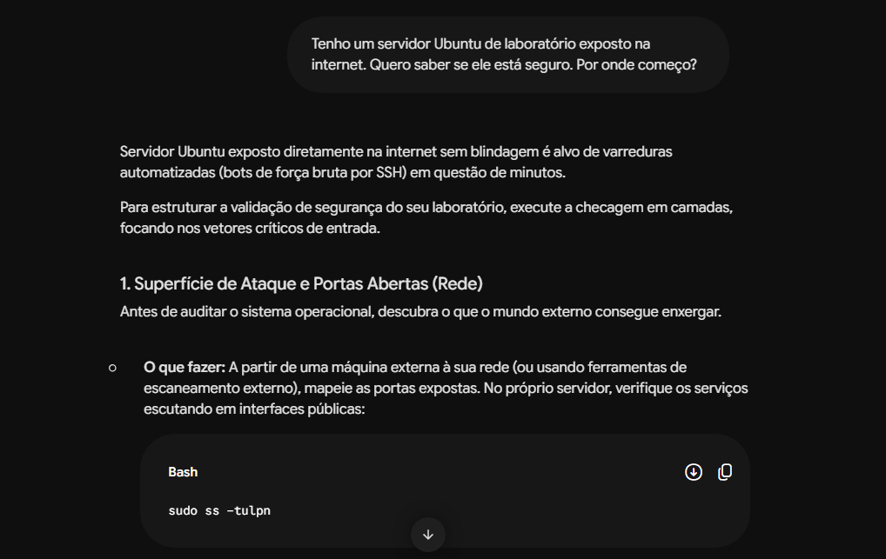

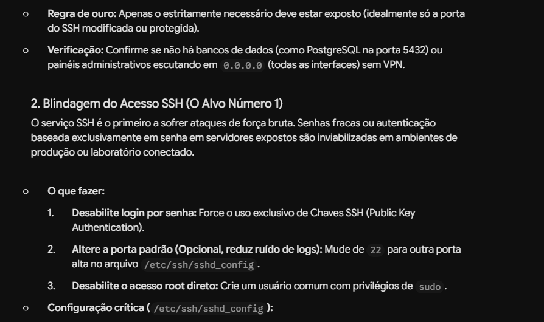

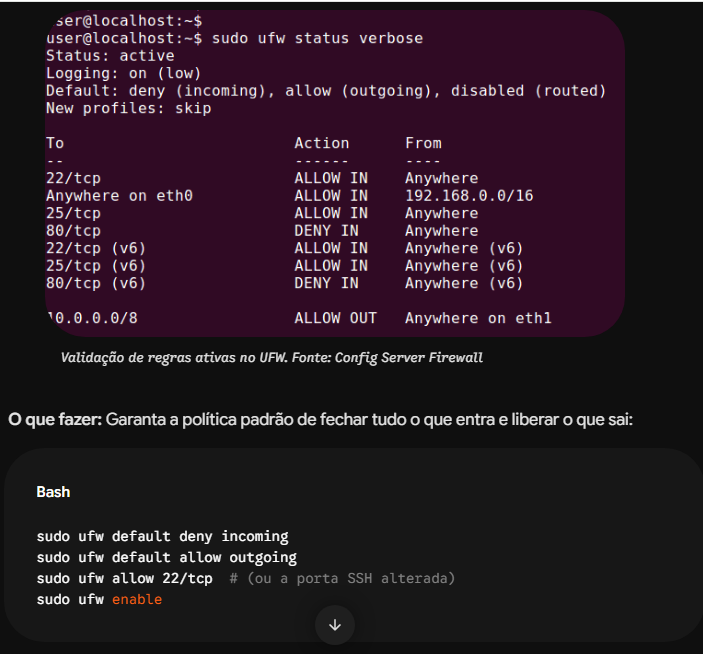

As outras partes da resposta estão em `evidencias/05c`, `05e`, `05f` e `05g`.

A diferença não é só de estilo. Seguido à risca no servidor deste cenário, o roteiro genérico causaria dois problemas:

- **Derrubaria o site:** as regras de firewall sugeridas liberam só a porta 22. Com `ufw default deny incoming` e `ufw enable`, o Apache na porta 80 deixa de responder. O chat não sabia que havia um Apache, porque não perguntou.
- **Poderia trancar o acesso:** a sugestão desliga o login por senha e reinicia o SSH. Num servidor acessado hoje com usuário e senha (o caso descrito), fazer isso antes de instalar e testar uma chave SSH tira o próprio acesso remoto.

É exatamente o que as regras "contexto antes de comando", "leitura antes de mudança" e "nada destrutivo sem confirmação" da skill evitam.

## Achados

**1. O filtro de segurança do modelo pode recusar a análise.** Um pedido de análise de código parecido com o que o agente atendeu no Teste 1 foi recusado nas três tentativas do Teste 2 ([`evidencias/02a`](evidencias/02a-recusa-sem-escopo.png) a [`02e`](evidencias/02e-recusa-terceira-tentativa.png)), inclusive quando o prompt deixava claro que o código era meu e de laboratório. No raciocínio, o modelo cita uma regra que já vem nas instruções dele e manda recusar análise de vulnerabilidades em código enviado pelo usuário, mesmo com autorização. Nas recusas, ele decidiu antes de abrir a skill. No Teste 1, leu a skill primeiro e seguiu o processo.

Conclusão: especializar um agente só com arquivos funciona, mas a especialização roda em cima de um modelo que tem as próprias regras, e elas vêm antes. Para uso real em AppSec, vale testar mais de um modelo e não depender de uma única resposta.

**2. Uma pergunta, um passo.** No cenário de infraestrutura, a regra "uma pergunta por vez" do `AGENTS.md`, somada ao passo 2 da skill, fez o agente conduzir a conversa em etapas, em vez de despejar um questionário. É mais lento, mas cada resposta já usa o que foi dito antes.

## Ética

Todos os testes usam apenas código e máquinas de laboratório próprios. A skill tem como regra recusar análise ofensiva de sistemas sem autorização.

## Créditos

Baseado no [DIO Agent](https://github.com/digitalinnovationone/dio-agent), da Digital Innovation One. Desafio proposto no bootcamp *Cibersegurança do Zero à Prática*, com aulas da Expert Isadora.
